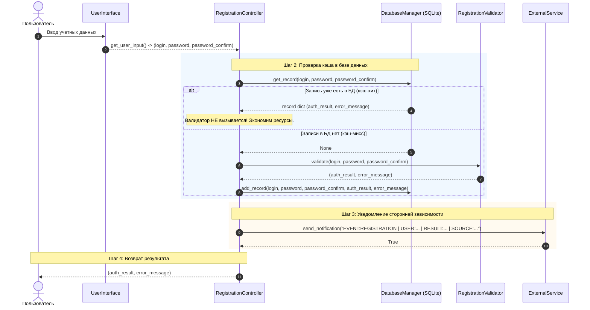

# 🛡️ Полное руководство к безупречной защите Лабораторной работы № 3

## 📌 Паспорт работы
* **Тема:** «Интеграционное тестирование проектов и работа с тестовыми заглушками»
* **Дисциплина:** Проектирование и тестирование программных модулей (ПТПМ)
* **Студент:** Романов Р. О.
* **Преподаватель:** Кошман В. Е.
* **Репозиторий:** `https://github.com/romanovro-arch/PTPM-VKI`
* **Ветка Git:** `Lab3`

---

## 💡 В чём главная суть и «прикол» этого задания?

В Лабораторных работах № 1 и № 2 вы писали алгоритмы и проверяли их изолированными юнит-тестами (тестировали отдельные функции «в вакууме»). 

В **Лабораторной работе № 3** фокус принципиально смещается:
1. **От функций к промышленной архитектуре:** проект переписан на объектно-ориентированную модульную систему со строгим разделением ответственности (Single Responsibility Principle) и инверсией зависимостей (Dependency Injection).
2. **Кэширование бизнес-логики (Memoization в БД):** контроллер не считает результат каждый раз заново. Если связка «логин-пароль-подтверждение» уже однажды проверялась — результат мгновенно извлекается из SQLite без вызова валидатора.
3. **Изоляция сторонних зависимостей (Mocking):** реальный софт в продакшене не должен при каждом тесте слать настоящие email на почтовый сервер или ждать ответа от живого пользователя. Все внешние точки соприкосновения подменяются контролируемыми дублёрами (`unittest.mock`).
4. **Интеграционное тестирование против модульного:** здесь проверяются не регулярные выражения, а **стыки компонентов** — как `Controller` координирует `UserInterface`, `DatabaseManager`, `RegistrationValidator` и `ExternalService`.

---

## 🚀 Команды для демонстрации преподавателю

### 1. Автоматический прогон всех тестов (100% OK):
```powershell
python -m unittest discover -v
```
> Запускает **все 8 тестов** проекта (4 интеграционных + 4 модульных). Тесты выполняются за ~0.01 секунды и завершаются со статусом `OK`.

### 2. Запуск только интеграционных тестов:
```powershell
python -m unittest tests/test_integration.py -v
```
> Демонстрирует 4 сквозных сценария взаимодействия контроллера с **реальной базой данных SQLite** в памяти (`:memory:`).

### 3. Запуск модульных тестов с заглушками:
```powershell
python -m unittest tests/test_units_and_mocks.py -v
```
> Демонстрирует работу `patch('builtins.input')`, `MagicMock` и строгий контроль порядка вызовов.

### 4. Запуск интерактивного приложения:
```powershell
python main.py
```
> Запуск сквозного сценария через консоль: введите логин, пароль и подтверждение — программа проверит БД, провалидирует данные, запишет в локальную базу `registration.db` и сымитирует отправку email.

---

## 📐 Архитектура классов (строго по пунктам 'a'–'e' ТЗ)

| Пункт ТЗ | Файл | Класс | Роль и устройство | Методы |
| :--- | :--- | :--- | :--- | :--- |
| **a. Класс вычислений / валидации** | `src/registration_validator.py` | `RegistrationValidator` | Содержит логику валидации из ЛР1. Проверяет маски логина (телефон/email/строка), черный список и сложность пароля. | **Ровно один метод** бизнес-логики по ТЗ:<br>`validate(login, password, password_confirm) -> Tuple[bool, str]` |
| **b. Класс базы данных** | `src/database.py` | `DatabaseManager` | Инкапсулирует работу с SQLite (`sqlite3`). Поддерживает файл `registration.db` и `:memory:`. Составной первичный ключ: `(login, password, password_confirm)`. | 1. `add_record(login, pwd, confirm, auth_result, err)`<br>2. `get_record(login, pwd, confirm) -> dict \| None`<br>3. `delete_record(login, pwd, confirm) -> bool`<br>4. `close()` |
| **c. Взаимодействие с пользователем** | `src/user_interface.py` | `UserInterface(ABC)`<br>`ConsoleUserInterface` | Интерфейс на базе модуля `abc` (Abstract Base Class). Конкретная консольная реализация получает данные через функции `input()`. | `get_user_input() -> Tuple[str, str, str]` |
| **d. Сторонняя зависимость** | `src/external_service.py` | `ExternalService(ABC)`<br>`EmailNotificationService` | Абстрактный интерфейс (`abc.ABC`) и класс имитации отправки уведомлений на внешний email-сервер. Внутри исключительно имитация передачи данных (запись в историю `sent_payloads`). | `send_notification(payload: str) -> bool` |
| **e. Контроллер (Controller)** | `src/controller.py` | `RegistrationController` | Сердце системы. Реализует сквозной сценарий бизнес-логики. Все зависимости получает снаружи через конструктор (Dependency Injection). | `run_registration() -> Tuple[bool, str]` |

---

## 🔄 Детальный сквозной алгоритм работы Controller (`run_registration`)

Контроллер выполняет 4 шага в строгой последовательности (п. 'e' ТЗ):



---

## 🧪 Разбор всех 8 тестов проекта: что и как проверяет каждый тест

### Набор 1: Интеграционные тесты (`tests/test_integration.py`)
*Все тесты используют **реальную базу данных SQLite в памяти (`:memory:`)**, проверяя реальные SQL-запросы `INSERT`, `SELECT`, `DELETE`.*

1. **`test_integration_successful_registration_saves_to_db_and_notifies_external_service`**
   * *Суть:* Полный сквозной цикл нового пользователя с валидными данными (`+7-999-123-4567`, `Пароль1!`).
   * *Что проверяет:* Записи в БД не было $\rightarrow$ вызвался валидатор $\rightarrow$ валидатор вернул успех $\rightarrow$ в SQLite реально появилась запись с `auth_result=1` $\rightarrow$ сторонний сервис получил строку с меткой `SOURCE:CALCULATION` $\rightarrow$ контроллер вернул `(True, "")`.

2. **`test_integration_cached_database_record_bypasses_validator_calculation`**
   * *Суть:* Проверка механизма кэширования в БД.
   * *В чём прикол:* Мы заранее записываем пользователя в SQLite БД. Затем запускаем контроллер, передав вместо обычного валидатора шпион `spy_validator = MagicMock(spec=RegistrationValidator)`. Тест проверяет, что `spy_validator.validate.assert_not_called()`! То есть валидатор **не вызывался вовсе**, данные взяты из БД, а во внешнее уведомление ушла метка `SOURCE:DATABASE`.

3. **`test_integration_failed_registration_persists_error_to_database`**
   * *Суть:* Сквозной цикл при передаче слабого пароля (`weak123`).
   * *Что проверяет:* Валидатор возвращает ошибку $\rightarrow$ в базу данных SQLite успешно записывается `auth_result=0` и текст ошибки $\rightarrow$ внешний сервис уведомляется о сбое `RESULT:FAILED` $\rightarrow$ контроллер возвращает `(False, "текст ошибки")`.

4. **`test_integration_database_crud_lifecycle`**
   * *Суть:* Проверка надежности самого модуля `DatabaseManager`.
   * *Что проверяет:* Добавление записи (`add_record`), извлечение по составному ключу (`get_record`), защита от чужого пароля (попытка запросить с другим `password_confirm` возвращает `None`), удаление записи (`delete_record`) и проверка, что повторное удаление возвращает `False`.

---

### Набор 2: Модульные тесты с заглушками (`tests/test_units_and_mocks.py`)
*Проверяют изолированную работу отдельных компонентов и поведение фреймворка заглушек `unittest.mock`.*

5. **`test_controller_strict_execution_order_with_full_mocks`**
   * *Суть:* Тестирование контроллера в 100% изоляции (все 4 зависимости — это `MagicMock`).
   * *Что проверяет:* Строгую последовательность вызовов `ui.get_user_input` $\rightarrow$ `db.get_record` $\rightarrow$ `validator.validate` $\rightarrow$ `db.add_record` $\rightarrow$ `external_service.send_notification` и корректность передаваемых аргументов.

6. **`test_console_user_interface_input_mocking`**
   * *Суть:* Тестирование интерактивного консольного ввода `ConsoleUserInterface`.
   * *В чём прикол:* Тесты выполняются автоматически без человека. Декоратор `@patch('builtins.input', side_effect=['+7-999...', 'Пароль1!', 'Пароль1!'])` перехватывает встроенную функцию `input()` и подает тестовые строки. Метод возвращает корректный кортеж из трех строк.

7. **`test_email_notification_service_payload_simulation`**
   * *Суть:* Проверка контракта сторонней службы `EmailNotificationService`.
   * *Что проверяет:* При передаче строки возвращается `True`, а строка фиксируется в `sent_payloads`. При передаче нестрокового типа (число) сервис выбрасывает `TypeError`.

8. **`test_validator_contract_and_non_string_types`**
   * *Суть:* Проверка контракта единственного метода `RegistrationValidator.validate`.
   * *Что проверяет:* Отклонение `None`/чисел, отклонение пустых строк и несовпадающих паролей.

---

## 💣 Топ-10 каверзных вопросов душного преподавателя и бронебойные ответы

### Вопрос 1: *«Почему у вас в `RegistrationValidator` только один метод? Где остальные?»*
> **Ответ:**  
> «В точном соответствии с формулировкой подпункта 'a' раздела 'Архитектура проекта' методички: *«Класс вычислений / валидации: Класс с одним методом, который был реализован в задании Лабораторная работа №1»*. Единственный публичный метод `validate(login, password, password_confirm)` полностью реализует всю цепочку проверок (формат логина, проверка черного списка, длина и сложность пароля по кириллице, цифрам и спецсимволам). Добавление других публичных методов нарушило бы строгое требование ТЗ.»

---

### Вопрос 2: *«Почему в БД составной первичный ключ по логину, паролю И подтверждению? Это же нарушает нормальные формы БД!»*
> **Ответ:**  
> «С точки зрения классической реляционной теории это избыточно, однако это **прямое требование технического задания** в подпункте 'b':  
> *«Для проекта „Регистрация“ одна запись БД содержит данные: логин, пароль, подтверждение_пароля, результат_авторизации, сообщение_об_ошибке... каждая запись идентифицируется по логину, паролю и подтверждению пароля»*.  
> В учебной задаче запись фиксирует конкретную попытку отправки формы регистрации со всеми тремя введёнными полями. Поэтому в таблице объявлен составной ключ:
> ```sql
> PRIMARY KEY (login, password, password_confirm)
> ```
> Благодаря этому при изменении любого из трех полей создается отдельная запись, а при полном совпадении всех трех полей срабатывает кэширование.»

---

### Вопрос 3: *«Что такое Dependency Injection (внедрение зависимостей) и зачем вы передаете классы в `Controller.__init__`, вместо того чтобы создать их внутри через `self.db = DatabaseManager()`?»*
> **Ответ:**  
> «Это фундаментальный принцип инверсии зависимостей (буква **D** в принципах **SOLID**).  
> Если бы `Controller` жестко создавал зависимости внутри себя через `DatabaseManager()`, мы бы никогда не смогли:
> 1. Протестировать контроллер изолированно от базы данных и внешнего мира (нельзя было бы подставить моки).
> 2. Подменить реальную файловую БД на in-memory базу `:memory:` для быстрых тестов.
> 3. Подменить консольный UI на графический интерфейс (Tkinter/Web) без переписывания контроллера.  
> Передавая зависимости в конструктор, мы делаем контроллер слабосвязанным и на 100% тестируемым.»

---

### Вопрос 4: *«Чем интеграционный тест принципиально отличается от модульного (юнит)? Покажите оба в вашем коде.»*
> **Ответ:**  
> * **Модульный тест (`test_units_and_mocks.py`)** проверяет один изолированный класс/метод. Все зависимости вокруг него заменены пустышками (`Mock`). Мы проверяем только внутреннюю логику самого класса (например, тест `test_controller_strict_execution_order_with_full_mocks`).
> * **Интеграционный тест (`test_integration.py`)** проверяет **взаимодействие нескольких реальных модулей между собой**. В тесте `test_integration_successful_registration_saves_to_db_and_notifies_external_service` контроллер работает с **реальным валидатором** и выполняет **настоящие SQL-запросы к реальному движку SQLite**, подтверждая, что схема таблицы, типы данных и логика контроллера согласованы между собой.

---

### Вопрос 5: *«Зачем в тестах используется `sqlite3.connect(':memory:')`, а не обычный файл `registration.db`?»*
> **Ответ:**  
> «По трем ключевым причинам:
> 1. **Абсолютная изоляция тестов:** база данных в памяти создается с нуля в `setUp()` и уничтожается в `tearDown()`. Тесты не зависят друг от друга и не накапливают мусорные данные.
> 2. **Скорость:** работа в ОЗУ происходит в десятки раз быстрее, чем дисковые операции ввода-вывода (I/O).
> 3. **Отсутствие побочных эффектов:** тесты не создают временных файлов на диске и гарантированно работают одинаково на Windows, Linux и в CI/CD серверах.»

---

### Вопрос 6: *«Как в тесте №2 доказывается, что при наличии записи в БД валидатор действительно НЕ вызывался?»*
> **Ответ:**  
> «В тесте `test_integration_cached_database_record_bypasses_validator_calculation` мы передаем в контроллер валидатор, обернутый в объект-шпион библиотеки mock:
> ```python
> spy_validator = MagicMock(spec=RegistrationValidator)
> ```
> После запуска `controller.run_registration()` мы вызываем специальное утверждение фреймворка:
> ```python
> spy_validator.validate.assert_not_called()
> ```
> Если бы контроллер по ошибке попытался вызвать `validate()`, тест немедленно упал бы с `AssertionError: Expected 'validate' to not have been called. Called 1 times`.»

---

### Вопрос 7: *«Как работает `@patch('builtins.input')` в тесте интерфейса?»*
> **Ответ:**  
> «Декоратор `unittest.mock.patch` временно перехватывает атрибут `input` в глобальном пространстве имен `builtins`. На время выполнения теста вместо стандартной функции ожидания ввода с клавиатуры подставляется Mock-объект. Параметр `side_effect=['логин', 'пароль', 'пароль']` задает генератор ответов: при первом вызове `input()` возвращается логин, при втором — пароль, при третьем — подтверждение. По завершении тестового метода `patch` автоматически восстанавливает оригинальную функцию `input()` обратно.»

---

### Вопрос 8: *«В чём разница между Stub, Mock и Spy по классификации Мартина Фаулера?»*
> **Ответ:**  
> 1. **Dummy (Пустышка):** объект, который просто передается для заполнения сигнатуры метода, но никогда не вызывается.
> 2. **Stub (Заглушка):** объект, возвращающий жестко зашитые предопределенные данные на вызовы (например, наш `mock_ui.get_user_input.return_value = (...)`).
> 3. **Spy (Шпион):** реальный или поддельный объект, который дополнительно запоминает факт и аргументы вызовов (как `spy_validator` для проверки `assert_not_called()`).
> 4. **Mock (Имитатор):** объект с предварительно запрограммированными ожиданиями, который сам валидирует протокол взаимодействия (как проверка `assert_called_once_with(...)`).»

---

### Вопрос 9: *«Зачем вы использовали модуль `abc` и декоратор `@abstractmethod` для `UserInterface` и `ExternalService`?»*
> **Ответ:**  
> «В Python нет ключевого слова `interface` как в Java или C#. Модуль `abc` (Abstract Base Classes) позволяет объявить строгий архитектурный контракт:
> 1. Если программист попытается создать экземпляр базового класса `UserInterface()`, Python выбросит ошибку: `TypeError: Can't instantiate abstract class UserInterface with abstract method get_user_input`.
> 2. Если класс-наследник забудет реализовать метод `get_user_input()`, он также не сможет быть инстанциирован.  
> Это гарантирует, что любая замена UI или внешнего сервиса будет строго соответствовать контракту контроллера.»

---

### Вопрос 10: *«Почему для базы данных вы написали собственный класс `DatabaseManager`, а не взяли SQLAlchemy или Django ORM?»*
> **Ответ:**  
> «В разделе 'Стек технологий' методички четко указано:  
> *«База данных: SQLite (встроенный модуль sqlite3) или любая другая БД на выбор... Инструмент тестирования: Встроенный модуль unittest.mock (стандартная библиотека Python)»*.  
> Использование встроенного модуля `sqlite3` из стандартной библиотеки Python исключает внешние сторонние зависимости, обеспечивает максимальную скорость работы и полностью соответствует академическим требованиям учебного курса.»

---

### Вопрос 11: *«Назовите 4 принципа ООП и покажите, как конкретно каждый из них применяется в архитектуре ЛР3?»*
> **Ответ:**  
> В архитектуре ЛР3 наглядно задействованы **все 4 принципа ООП**:
> 1. **Инкапсуляция:**  
>    * `DatabaseManager` инкапсулирует (скрывает) внутри себя низкоуровневое соединение `self._connection` и SQL-запросы, предоставляя наружу только чистые методы бизнес-логики (`add_record`, `get_record`, `delete_record`).
>    * `RegistrationValidator` инкапсулирует регулярные выражения и словарь запрещённых логинов внутри метода `validate()`.
> 2. **Наследование:**  
>    * `ConsoleUserInterface` наследует абстрактный класс `UserInterface`.
>    * `EmailNotificationService` наследует абстрактный класс `ExternalService`.
>    * Тестовые классы `TestUnitsAndMocks` и `TestRegistrationIntegration` наследуются от `unittest.TestCase`.
> 3. **Полиморфизм:**  
>    * Контроллер `RegistrationController` полиморфно работает с абстрактным интерфейсом `UserInterface`. В продакшене ему передаётся `ConsoleUserInterface`, а в тестах — подменяющий `MagicMock(spec=UserInterface)`. Контроллер вызывает `ui.get_user_input()`, не зная конкретного типа объекта. Мы можем легко добавить `TkinterUserInterface` без изменения единой строчки контроллера.
> 4. **Абстракция:**  
>    * Выделение базовых интерфейсов через модуль `abc.ABC` и декоратор `@abstractmethod` (`UserInterface`, `ExternalService`). Мы проектируем систему на уровне абстрактных контрактов взаимодействия, отсекая второстепенные детали реализации консоли или SMTP-сети.

---

### Вопрос 12: *«В чём разница между модульным (Unit) и интеграционным тестированием простыми словами?»*
> **Ответ:**  
> * **Аналогия:** Юнит-тест — это проверка отдельной детали на верстаке в вакууме (например, генератора автомобиля мультиметром). Интеграционный тест — это проверка деталей в связке (генератор установили в мотор, натянули ремень и проверили, идёт ли заряд на аккумулятор).
> * **В нашем проекте:**
>   * **Юнит-тесты (`test_units_and_mocks.py`):** проверяют один класс в полной изоляции. Базы данных и пользователя нет — все зависимости заменены заглушками (`MagicMock`). Проверяем только алгоритмы и строгую очередность вызовов контроллера.
>   * **Интеграционные тесты (`test_integration.py`):** проверяют **стыки** компонентов. Контроллер работает с **реальной базой данных SQLite** (`:memory:`) и реальным валидатором, проверяя, что SQL-схема таблицы, типы данных и логика кэширования согласованы между собой.

---

### Вопрос 13: *«Что такое Mock, MagicMock и patch? Назовите их основные методы и переменные.»*
> **Ответ:**  
> * **Mock / MagicMock:** объект-дублёр («манекен»), который притворяется реальным классом или функцией. `MagicMock` в отличие от `Mock` умеет эмулировать магические методы Python (`len()`, `with` контекстные менеджеры `__enter__/__exit__`, итерации).
> * **Переменные настройки поведения:**
>   * `return_value` — жестко задает значение, которое возвращает мок при вызове (`mock_ui.get_user_input.return_value = (...)`).
>   * `side_effect` — динамическое поведение: список возвращаемых значений по очереди (как при серии `input()`) либо возбуждение ошибки (`side_effect=Exception`).
>   * `spec` — ограничивает мок атрибутами реального класса, защищая от опечаток (`MagicMock(spec=UserInterface)`).
> * **Методы проверки (Asserts шпиона):**
>   * `assert_called_once()` — проверяет, что метод был вызван строго 1 раз.
>   * `assert_called_once_with(...)` — проверяет, что метод был вызван ровно 1 раз и с точными аргументами.
>   * `assert_not_called()` — гарантирует, что метод ни разу не вызывался (так мы проверяем кэш БД: если запись есть, валидатор не вызывается).
> * **Переменные инспекции истории:**
>   * `call_count` — число вызовов метода (`self.assertEqual(mock_input.call_count, 3)`).
>   * `call_args` — аргументы последнего вызова (`payload = mock_external.send_notification.call_args[0][0]`).
> * **`@patch`:** декоратор, временно подменяющий глобальный объект или функцию в памяти на время теста (например, `@patch('builtins.input')`).

---

## 📋 Итоговый чек-лист перед сдачей
- [x] Ветка Git: **`Lab3`**.
- [x] Нет лишних файлов от прошлых работ (удалены `delivery_service.py`, `build_report.py`, `my_project.py` и старые тесты).
- [x] Все 5 классов реализованы строго по структуре ТЗ ('a', 'b', 'c', 'd', 'e').
- [x] Написано **8 тестов** (4 интеграционных с реальной SQLite + 4 модульных с моками).
- [x] Все тесты проходят: `Ran 8 tests in 0.010s. OK`.
- [x] Код закоммичен и отправлен на GitHub (`origin/Lab3`).
- [x] Вы понимаете каждую строчку и можете ответить на любой каверзный вопрос по этому руководству.
