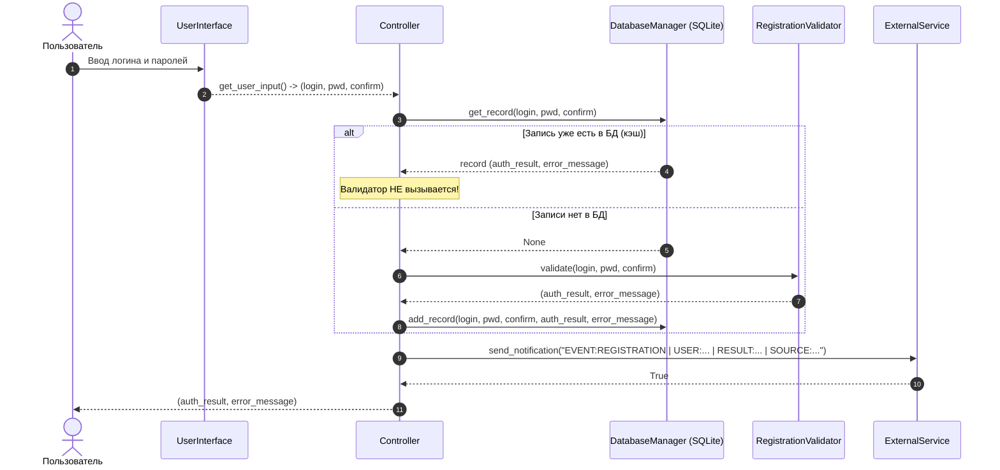

# 📘 Руководство к защите Лабораторной работы № 3

## 📌 Тема работы
**«Интеграционное тестирование проектов и работа с тестовыми заглушками»**  
**Дисциплина:** Проектирование и тестирование программных модулей (ПТПМ)  
**Репозиторий:** `https://github.com/romanovro-arch/PTPM-VKI`  
**Ветка:** `Lab3`

---

## 🚀 Как запускать проект и тесты

### 1. Автоматический запуск всех тестов проекта (интеграционные + с заглушками):
```powershell
python -m unittest discover -v
```
> Автоматически находит и выполняет все **8 тестов** (4 интеграционных сценария с реальной базой данных и 4 модульных теста с изоляцией моками). Результат: **100% OK**.

### 2. Запуск только интеграционных тестов:
```powershell
python -m unittest tests/test_integration.py -v
```
> Запускает **4 интеграционных теста** сквозных сценариев (регистрация нового пользователя, кэширование в БД, обработка ошибок валидации, полный жизненный цикл CRUD в SQLite).

### 3. Запуск модульных тестов с тестовыми заглушками:
```powershell
python -m unittest tests/test_units_and_mocks.py -v
```
> Проверяет изоляцию `Controller`, подмену консольного ввода `builtins.input` через `@patch`, контракт метода `RegistrationValidator.validate` и имитацию сетевой передачи `EmailNotificationService`.

### 4. Запуск интерактивного приложения:
```powershell
python main.py
```
> Запускает сквозной сценарий регистрации в интерактивном режиме с запросом ввода у пользователя, сохранением в `registration.db` и отправкой уведомления.

---

## 📐 Архитектура классов проекта (согласно ТЗ)

| Компонент / Файл | Класс | Роль в архитектуре | Реализованные методы |
| :--- | :--- | :--- | :--- |
| **a. Вычисления / валидация**<br>`src/registration_validator.py` | `RegistrationValidator` | Выполняет проверку корректности логина (телефон, email, строка) и сложности пароля (кириллица, цифры, спецсимволы). | `validate(login, password, password_confirm) -> Tuple[bool, str]` *(ровно один метод по ТЗ)*. |
| **b. Работа с базой данных**<br>`src/database.py` | `DatabaseManager` | Управление таблицей `registrations` в SQLite (поддерживает файл `registration.db` и `:memory:` для тестов). Составной ключ: `(login, password, password_confirm)`. | 1. `add_record(login, pwd, confirm, auth_result, err)`<br>2. `get_record(login, pwd, confirm)`<br>3. `delete_record(login, pwd, confirm)` |
| **c. Взаимодействие с пользователем**<br>`src/user_interface.py` | `UserInterface(ABC)`<br>`ConsoleUserInterface` | Абстрактный интерфейс (`abc.ABC`) и консольная реализация получения данных от пользователя через `input()`. | `get_user_input() -> Tuple[str, str, str]` |
| **d. Сторонняя зависимость**<br>`src/external_service.py` | `ExternalService(ABC)`<br>`EmailNotificationService` | Абстрактный интерфейс (`abc.ABC`) и реализация имитации передачи данных внешнему email-серверу / процессу. | `send_notification(payload: str) -> bool` |
| **e. Контроллер (Controller)**<br>`src/controller.py` | `RegistrationController` | Объединяющий класс сквозного сценария. Принимает все зависимости через конструктор (Dependency Injection). | `run_registration() -> Tuple[bool, str]` |

---

## 🔄 Сквозной сценарий работы контроллера (`run_registration`)



---

## 🎯 Шпаргалка к вопросам на защите

### 1. Что такое интеграционный тест и чем он отличается от модульного (юнит)?
* **Модульный тест (Unit Test):** проверяет работу отдельной функции или класса в полной изоляции. Все внешние зависимости (БД, сеть, пользовательский ввод) заменяются моками (`unittest.mock.MagicMock`).
* **Интеграционный тест (Integration Test):** проверяет корректность совместной работы двух или более реальных компонентов (в нашей работе: `Controller` + реальная база данных `SQLite` + `RegistrationValidator`).

### 2. Зачем нужны тестовые заглушки (Mocks, Stubs, Spies)?
1. **Изоляция:** позволяют тестировать бизнес-логику контроллера независимо от готовности внешних сервисов или наличия сетевого соединения.
2. **Детерминированность и скорость:** тесты не зависят от внешнего окружения, не шлют реальные email и выполняются за миллисекунды.
3. **Проверка взаимодействия:** с помощью `assert_called_once_with(...)` или `assert_not_called()` проверяется, какие параметры переданы и вызывался ли метод вообще (например, проверка, что при кэшировании в БД валидатор не вызывается повторно).

### 3. Как устроена идентификация записей в БД?
В соответствии с ТЗ:
> *«каждая запись идентифицируется по логину, паролю и подтверждению пароля»*

В SQLite таблице `registrations` объявлен составной первичный ключ:
```sql
PRIMARY KEY (login, password, password_confirm)
```
Это гарантирует однозначную идентификацию и корректную работу методов `get_record` и `delete_record`.
